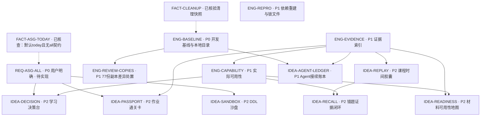
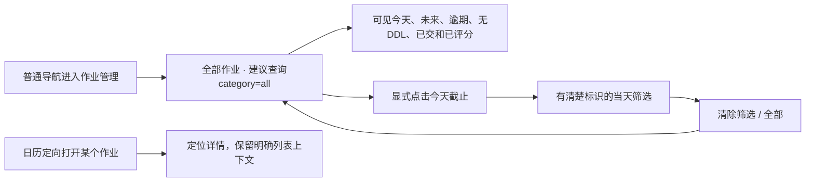

# 项目改进图谱与 Agent 接续入口

日期：2026-10-17（Asia/Shanghai）。静态核查基线：`b09c39e3560cfe70b0142aab93d7b1c2411bd173`。

**当前交付是图谱、日志和实施规格。作业“默认全部”是用户明确需求，仍待业务实现；下方大胆想法均未宣称已实现或有效。**

## 先读什么

1. [最新改进日志](2026-10-17.md)：事实、已完成清理、工程顺序、实验提案与交接规则。
2. [作业默认全部的实施规格](assignments-default-all.md)：首要任务，含固定 SHA 代码证据、前后端契约和验收矩阵。
3. [graph.json](graph.json)：可供 agent 读取的稳定节点 ID、状态、依赖、证据和验收条目。
4. [产品路线图](../../STUDENT_PRODUCT_ROADMAP.md)：长期定位与历史接续记录；本轮增补见第32节。

## 改进关系图

实线表示实施依赖，虚线表示事实驱动。`P0`是接续优先级，不是漏洞定级。`REQ-ASG-ALL`可以从干净的最新main直接开展，不必先等待本机旧review整合；`ENG-BASELINE`用于本机目录治理与后续协作。

## 可立即接续的任务

|ID|结论或工作|状态|接续建议|
|---|---|---|---|
|REQ-ASG-ALL|普通进入作业管理，默认全部作业|用户明确、待实现|优先前端+Bridge+本地/远端查询+fake回归|
|ENG-BASELINE|旧工作区与main身份不一致|工程建议|先保全现场并比对PR27，避免重复集成或覆盖|
|ENG-REPRO|`*.lock`会忽略未来Python锁文件|工程建议|选择锁定方案后加精确例外，验证干净重建|
|ENG-EVIDENCE|日志/截图需要可检索、可替代的索引|工程建议|记录commit、验证对象、证据层级、替代关系|
|IDEA-*|学习决策、作业通关、课程回放等|实验假设|每次只挑一个最小闭环，先检验价值|

## 作业页面应如何进入

上图“普通进入默认全部”来自用户明确要求；保留今天快捷入口、定向详情上下文及组合筛选是实施建议，详见规格中的层级标记。

## 维护方式

- 状态变更必须附commit、测试或运行证据；“写入日志”和“功能完成”分别记录。
- 先刷新main及工作目录实际状态；日志中的提交差距和本地冲突仅是带日期快照。
- 新想法沿用稳定ID，在新日期日志追加变更原因；不把旧测试数字当当前验收结果。
- 本次只有文档发布授权；后续agent读取此图谱不自动取得真实数据提交、部署、迁移或清理授权。
