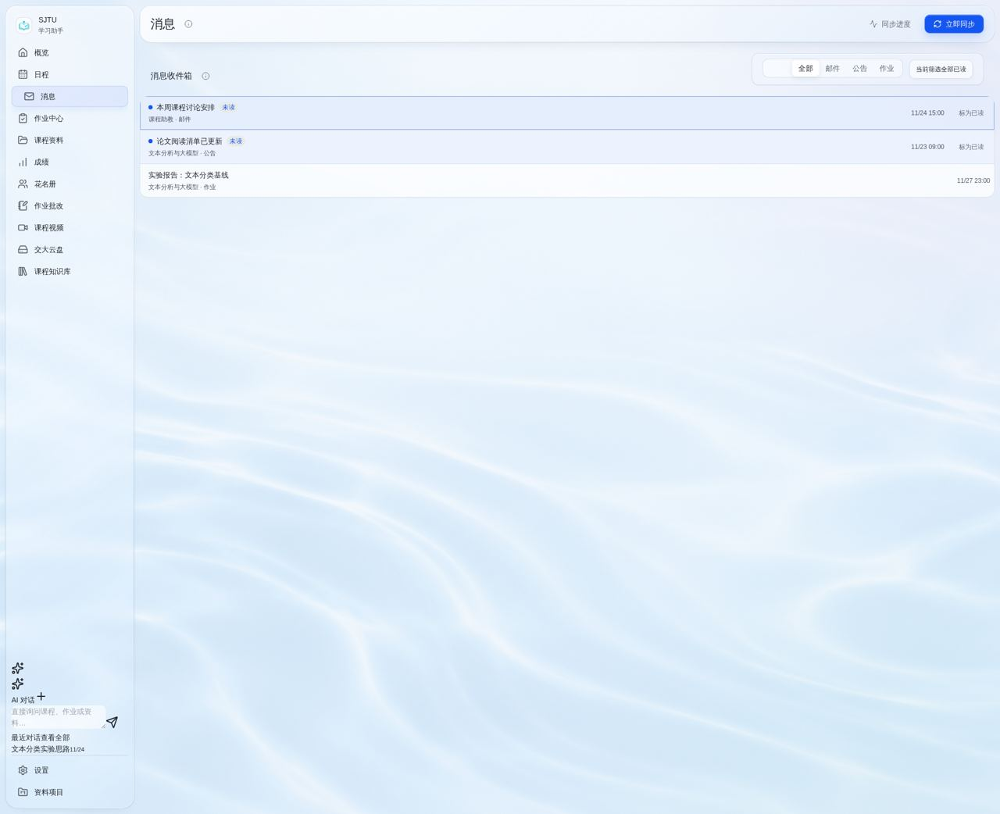
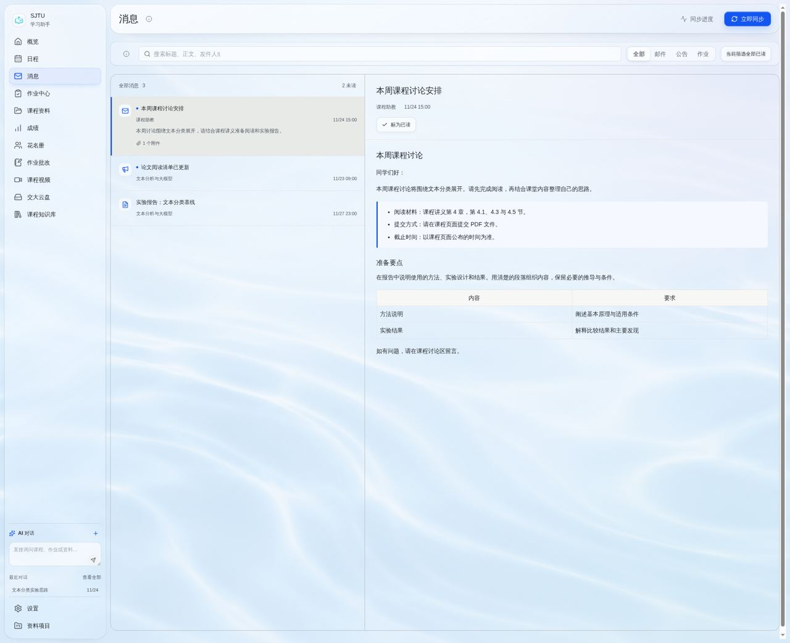

# 消息中心迭代（2026-11-25）

任务基线为 main 10af827。本机发现安装版 1.8.18；最新源码为 1.8.23。沿用 Mac 现有工作分支，沙盒在 fix/message-center-archive 上实现。

## 根因与实现

原收件箱查询三类来源各取最多100条，再合并截断100条。邮箱首次同步只读取最后100个UID，之后只拉更大的UID，旧消息没有回填入口。AI邮件关键词仅查摘要，作业仅查标题和课程。实际助手复核还发现：确定性预检索固定读取最近20条且来源为all，模型不继续调用工具时，历史邮件问题会被近期公告回答。

新收件箱采用复用课程资料搜索样式的双栏布局。列表与详情分别滚动，小窗口点击消息后单栏阅读并可返回。保留蓝白主题、类型图标、未读点、发件人、日期、摘要与附件数量。去掉重复类型文字和多余标签；不添加“本地可搜索”卡片、“本地归档”小标签或逐条手动加入AI按钮。正文白名单保留标题结构，排版支持段落、列表、引用、表格、图片及附件。

统一ORM检索在数据库中过滤标题、完整正文、课程和发件人，空格关键词取交集，再按时间与稳定ID分页。UI每页60条，可继续加载。复用相同查询给现有只读AI工具和MCP；每条引用包含标题、来源、时间及本地不透明编号，点击在消息中心定位。长正文AI读取提供next_offset续读。AI预检索按用户明确的邮件/公告/作业来源筛选，优先保留引号内的原词，否则识别用户实际写出的考试、期末、提交、排版等常用主题词；引用及关键词仍由同一全库查询生成，不支持模型工具调用的配置也能取得旧消息。未建立外部邮件索引，不自动调用模型或发送全库邮件。

邮箱以BODY.PEEK只读拉取完整邮件。新消息与历史分别读取，每批正文、附件映射和UID游标同事务保存；历史回填从新到旧，失败不跨越尚未保存的批次，重启继续。游标增加账户、history_before和history_complete字段，老游标重新枚举并按源ID去重。往期Canvas课程复用现有Link分页和ETag，按课程保存公告和作业；403/404保留缓存、不推进游标，账户目录与当前学期待办范围分开。

## 兼容与边界

本轮复用既有表与SyncState，不新增数据库列。旧版本能解析原last_uid/uid_validity字段，但回退旧版会恢复100条显示限制，并可能覆盖历史游标；旧消息正文仍留在数据库中。Canvas仅同步当前账号可访问的课程，关闭访问的历史资源无法强行获取；邮件范围是INBOX。当前可访问课程目录用于筛选历史课程，切换Canvas账户后需同步刷新目录。AI预检索有20条与上下文预算上限，未识别的主题可用引号指定原关键词；支持工具调用的模型可进一步按关键词搜索。模糊语义匹配沿用现有助手能力；本地搜索为空格关键词交集，不等同于向量语义搜索。

## 验证

合成151封邮件验证第101条及更早正文、尾部关键词、分类与关键词组合、重复同步已读保留、重开数据库、跨邮箱与课程目录隔离。模拟IMAP验证分批回填、中断续传、增量批次失败不跨UID，以及账户切换不复用旧游标。前端验证真实组件的双栏阅读、继续分页、迟到响应隔离、已读、键盘与AI本地引用定位。

沙盒及Mac初始定向Python107项和27个子测试通过；补修AI预检索后，消息、Agent运行与MCP关键回归66项/2子测试在沙盒和Mac均通过（新增5项覆盖旧邮件正文、来源限定、保留原词、中英文与往期作业）。Mac前端4个相关测试文件90项、沙盒前端全量623项通过；TypeScript与Vite生产构建通过。Python全量首次1531项通过、20项失败、4项初始化错误、3项跳过，576子测试通过；失败均为沙盒NO_PROXY配置引发的httpx地址解析错误，清理测试进程代理环境后24项全部通过，没有为环境问题修改业务代码。

Mac WKWebView合成夹具的初始完整正文、点击详情、返回列表、分页外AI引用定位4个场景通过。原生真实账户验收确认139封邮件、173条消息（18公告、16作业），第101条及更早消息可见；正文专属关键词命中，考试/作业/通知分别命中7/29/70封。旧邮件引用能打开同一消息，重开数据库计数一致；原生窄窗无横向溢出、没有多余标签。该检查通过真实本地DesktopBridge读取，未调用模型。

本轮仅使用合成内容制作公开UI截图。云端视觉检查未发现溢出/重叠，但网络观察未完成，真实接口依据以上Mac原生桥验收。

## 本机部署与真实同步

初次从102b8b7隔离源码快照构建1.8.23；发现AI预检索问题后，从精确提交2beb47bad00f600332edff8b15518cf83f735d30再次独立构建、验签与验包，前端资源复用已验证的同一生产构建。本机未找到持久签名身份，使用ad-hoc签名；codesign深度严格校验、macOS bundle和FFmpeg验包均通过。其他会话的知识编译与片段恢复改动留在原工作区，未纳入该包或消息中心提交。

2026-11-25已正常退出旧安装版1.8.18，安装、验签并启动1.8.23，AI恢复为原来的开启状态。退出期间先暂停新增AI请求，等待1个在途请求自然结束；旧应用随后通过原有退出协议排空后台线程，无强制终止。数据库、AI运行库与设置通过SQLite在线备份保存；旧包位于 `~/Applications/SJTU App Backups/SJTU Learning Assistant before message center 20261125.app`，数据备份位于同目录的 `message center data before 20261125`。AI补修再次安装时另保留 `SJTU Learning Assistant before message prefetch 20261125.app` 及 `message prefetch data before 20261125`，不会覆盖第一轮备份。旧包和已有备份均未被覆盖。

真实IMAP回填使邮件从139增至1169；再次同步仍为1169，无新增重复。只读源端UID核对为1169，本地当前UIDVALIDITY同为1169、缺失0、完整解析1169、解析失败0；历史游标完成且账户相符。邮件附件映射261条，对应本地文件261个。正文关键词考试/作业/通知命中34/382/689封。

真实Canvas同步覆盖46门往期课程，公告18→169、作业16→279；当前课程/待办范围保持一致。4项资源因源端访问限制被保留为未完成，不能宣称这些受限内容已经回填。全库现有1617条消息，其中1169邮件、169公告、279作业。

补修版安装完成后，使用最终安装包的前端资源与真实原生桥再次核验第101条、更早正文、引用定位及窄窗排版；全库1617条计数、标签移除与重开数据库均通过。安装程序与隔离构建程序SHA256均为 `2dd9baa313dd816f958723362cc8ea5b325378cbeb703052e1a464c018ac2d6a`，确认运行进程来自 `/Applications/SJTU Learning Assistant.app`。重复同步通过。安装后的实际二进制MCP检索返回34封考试邮件及本地引用。补修后的实际内嵌助手考试通知查询生成1条第100条之后的旧邮件引用；后端核对来源为email、属于当前账户，回答中的标题、来源、日期均与真实消息一致。该次测试调用现有已配置模型，通知正文和回答未导出到提交材料。

脱敏验收计数详见同目录 `acceptance.json`。macOS是本轮实机环境；Windows由共享代码与自动化测试覆盖，未做Windows真机安装。

## 复验入口

- `scripts/verify_message_center_macos.py`：原生合成界面验收。
- `scripts/verify_message_archive_local.py`：真实数据库、搜索、持久化与引用；`--sync`读取IMAP INBOX；`--native-html`用生产界面进行原生只读验收。
- `scripts/verify_message_canvas_local.py`：往期Canvas回填与当前待办范围核验。
- `scripts/verify_message_mail_inventory_local.py`：只读源端UID、完整解析与本地附件库存核对。
- `scripts/verify_message_ai_local.py`：创建一段本机验收对话，调用现有助手并核验可定位引用；结果只输出计数与布尔值。
- `scripts/deploy_message_center_20261125.py`：暂停、排空、正常退出、备份、验签、可回退替换及恢复AI；已有备份不会被覆盖。
